# WellSpring One — System Documentation and User Guide

**Integrated pharmacy POS, inventory, purchasing, reporting, and offline-workflow prototype**  
**Course:** Systems Integration and Architecture  
**Instructor:** Jessa May Condino  
**Version:** 1.0 submission baseline  
**Date:** November 26, 2026  
**Demonstration branch:** WS01 · Davao Main

> **Submission status.** WellSpring One is a functional browser prototype with a separate Express/Prisma/PostgreSQL implementation in source. Browser workflows and their stated QA checks are demonstrated; database-backed operation, real server synchronization, external integrations, production performance, and regulatory certification are not verified.

## 1. Executive summary

WellSpring One responds to a practical pharmacy operations problem: sales, stock, supplier receipts, and management reporting are difficult to reconcile when each activity is recorded separately. The prototype presents one coherent workstation for the daily cycle—from sign-in and checkout to stock visibility, purchasing, reports, and a labeled offline queue.

The submission demonstrates:

- Responsive sign-in and local demo signup;
- Role-aware navigation and workflow controls for eight pharmacy roles;
- POS search, cart, payment/customer selections, prescription attestation, totals, receipt, and stock deduction;
- Inventory filtering, valuation, expiry watch, and physical-count adjustment;
- Purchase-order drafting, approval, receiving, and stock updates;
- Dashboard metrics, sales charts, a transaction register, and CSV export;
- Local staff/audit administration and an explicit offline simulation;
- Ocean-and-mint WellSpring visuals, desktop/mobile layouts, and an 80 mm receipt view.

It does **not** yet prove centralized eight-branch operation, payment/accounting integration, automatic FEFO, real server sync, hardware integration, backup/restore, production security, BIR/RA 10173 compliance, or RFP performance targets.

### 1.1 Evidence legend

| Label | Meaning in this submission |
|---|---|
| **Demonstrated** | Observed in the browser or supported by the listed local automated check |
| **Source-verified** | Present in code but not accepted as runtime proof |
| **Ready to run** | Procedure or test prepared but not executed in the stated environment |
| **Production target** | RFP objective requiring future implementation and independent evidence |

## 2. Quick start

### 2.1 Requirements

- Node.js 20 or later;
- npm;
- A modern browser with JavaScript and `localStorage` enabled;
- No PostgreSQL server for the local browser demonstration.

### 2.2 Install and run

```bash
git clone https://github.com/kurunami31/WellSpring1.git
cd WellSpring1
npm ci
npm run dev --workspace=@wellspring/web -- --host 127.0.0.1
```

Open **http://127.0.0.1:5173**. The repository also retains `script.txt` with the original local startup command.

**Administrator demo:** `admin@wellspring.ph` / `password123`  
**Scope:** local evaluation only; never use these credentials or sample data in production.

### 2.3 Reset and privacy

Use **Offline & sync → Reset demo data** before a repeatable demonstration. This restores the operational demo dataset. Local signup profiles are separate; clear site data for a completely fresh browser profile. Do not enter real patient, customer, employee, payment, or confidential business data.

## 3. User and role guide

All eight seeded browser identities use `password123`. Quick-fill is provided for administrator, cashier, and branch manager; other accounts can be typed manually.

| Role | Demo email | Primary demonstrated responsibilities |
|---|---|---|
| System Admin | `admin@wellspring.ph` | Full local demonstration, staff records, audit view |
| Head Office Manager | `ho.manager@wellspring.ph` | Read-only operational views, PO approval, local reports; no central eight-branch data |
| Branch Manager | `branch1.mgr@wellspring.ph` | PO approval, reports, read-only staff/audit view |
| Cashier | `cashier1@wellspring.ph` | POS and receipt workflow |
| Pharmacist | `pharmacist1@wellspring.ph` | POS; read-only inventory |
| Inventory Staff | `inventory1@wellspring.ph` | Stock counts, receiving, read-only POS/reports access as implemented |
| Purchasing Officer | `purchasing1@wellspring.ph` | Draft and receive purchase orders |
| Store Supervisor | `supervisor1@wellspring.ph` | POS, stock counts, local reports |

Client-side route controls support the demonstration but are not production security boundaries. Server-side authorization must be independently verified before deployment.

### 3.1 Local signup

1. Open **Create account** on the desktop overlay, or use the compact Sign in/Create account switcher on smaller screens.
2. Enter a demo name, unique email, and matching password of at least eight characters.
3. Submit to create a browser-only cashier at **WS01 · Davao Main**.
4. Sign out and sign in again; email matching is case-insensitive on subsequent login.

Local passwords are stored in the browser solely for this labeled demo. Use a disposable demo password, never a real one.

## 4. Core workflows

### 4.1 Dashboard

The dashboard derives current browser-state metrics: today's revenue and transaction count, current stock units, low-stock count, seven-day sales trend, stock categories, fast-moving products, recent receipts, and stock/expiry alerts. Quick actions vary by role.

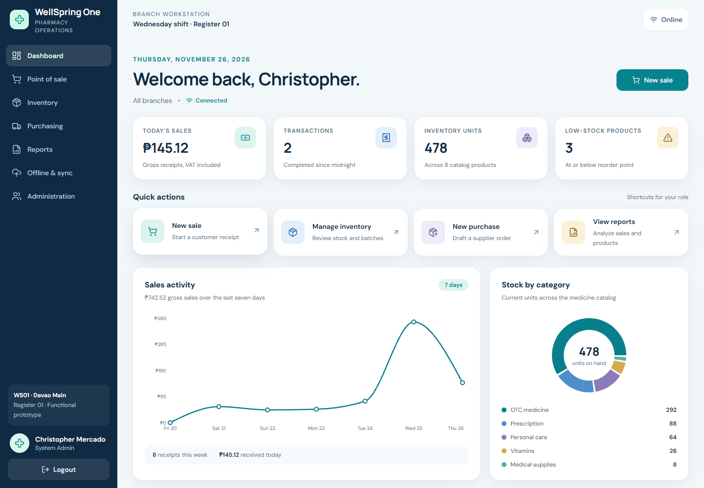

**Evidence:** local browser demonstration; figures are sample data, not business results or benchmarks.

### 4.2 POS checkout and receipt

1. Open **Point of sale** with an authorized role.
2. Search by product name, SKU, barcode, or category.
3. Add products and set whole-number quantities within available stock.
4. Select customer type and payment method. For prescription merchandise, confirm the pharmacist-review attestation.
5. For cash, enter enough tender or select **Exact amount**. For card/e-wallet, enter a demo reference.
6. Review totals and select **Charge**. The application creates the receipt and deducts local stock once.
7. Print or save the 80 mm receipt using the browser print command.

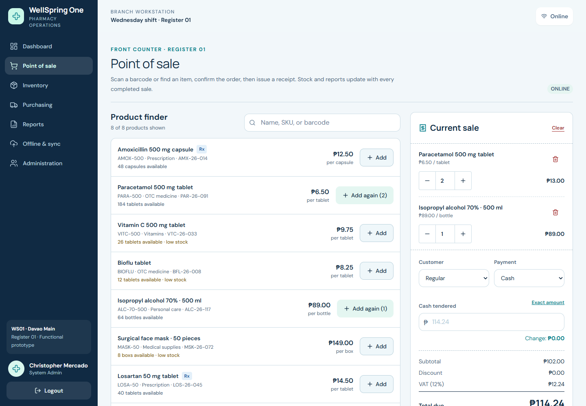

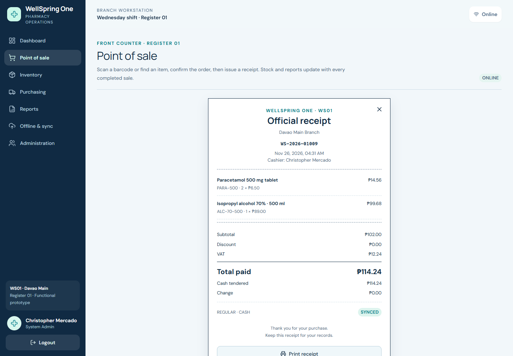

**Observed example:** receipt `WS-2026-01009`; Paracetamol changed from 184 to 182 tablets and alcohol from 64 to 63 bottles. This is functional evidence for the captured local transaction, not a concurrency or accounting test.

### 4.3 Inventory count

1. Open **Inventory** as inventory staff, supervisor, or administrator.
2. Search or filter by low stock, out of stock, or expiry watch.
3. Review stock valuation, reorder points, batch/expiry display, and recent movement entries.
4. Enter a nonnegative physical count and a reason.
5. Save the adjustment; local stock and movement/audit records update.

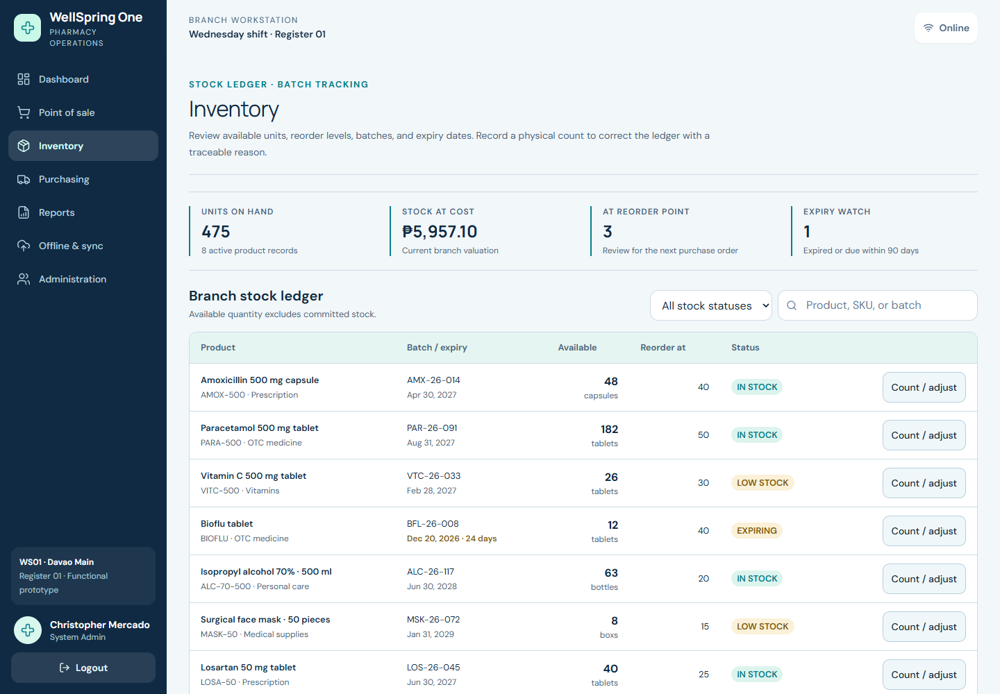

**Boundary:** one batch/expiry value per browser product; no automatic multi-batch FEFO, transfer UI, or centralized branch stock.

### 4.4 Purchasing and receiving

The normal non-administrator browser flow uses role handoff:

1. **Purchasing Officer:** create a draft PO with supplier, expected date, product, quantity, and cost.
2. **Branch Manager or Head Office Manager:** approve the draft; browser status moves `DRAFT → SENT`.
3. **Purchasing Officer or Inventory Staff:** receive the sent order; status moves `SENT → RECEIVED` and full listed quantities are added to stock.

The administrator can perform all local stages. The new-PO form has one line; seeded examples can contain multiple lines.

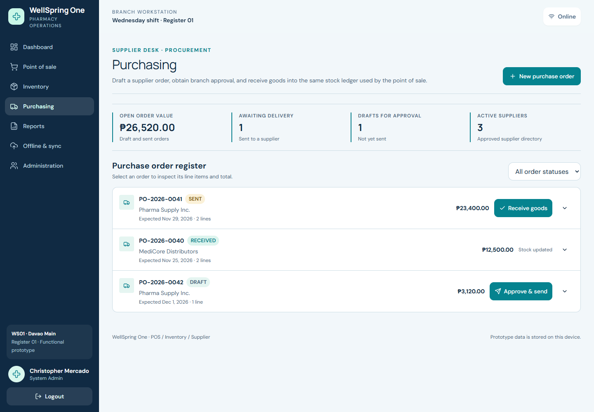

**Boundary:** no supplier-maintenance UI, partial/discrepant receiving, quality-check workflow, GRN document UI, or invoice-matching UI in the browser.

### 4.5 Reports and export

1. Open **Reports** with an authorized role.
2. Select today, seven days, or all demo records.
3. Review sales metrics, trend/category charts, and the transaction register.
4. Export the current local register to CSV.

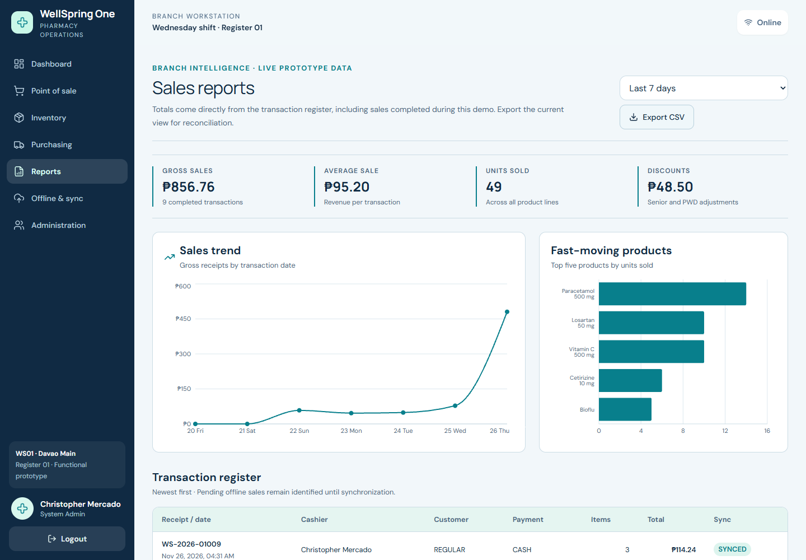

**Boundary:** reports use one browser's local data. They are not head-office consolidation, BIR certification, or proof of eight-branch reporting.

### 4.6 Offline queue and manual synchronization

1. Open **Offline & sync** and select **Simulate offline mode**.
2. Complete a sale in POS. Stock is deducted immediately and the sale is queued locally.
3. Return to Offline & sync and verify the pending entry.
4. Select **Restore online connection**, then **Sync now**.
5. Verify that the queue clears and stock is **not deducted a second time**.

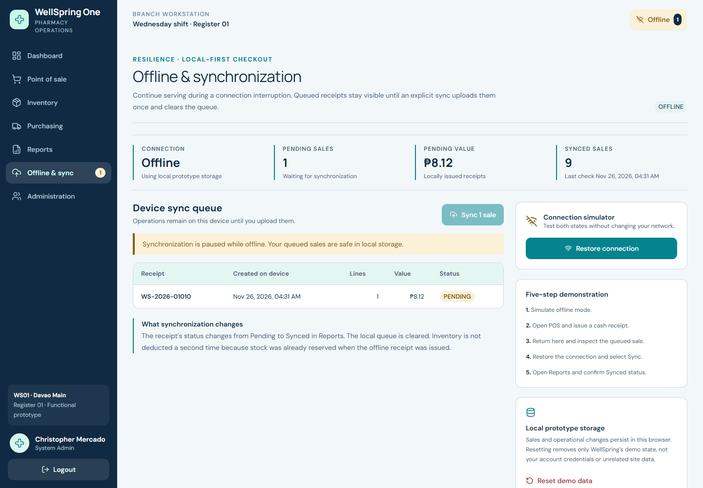

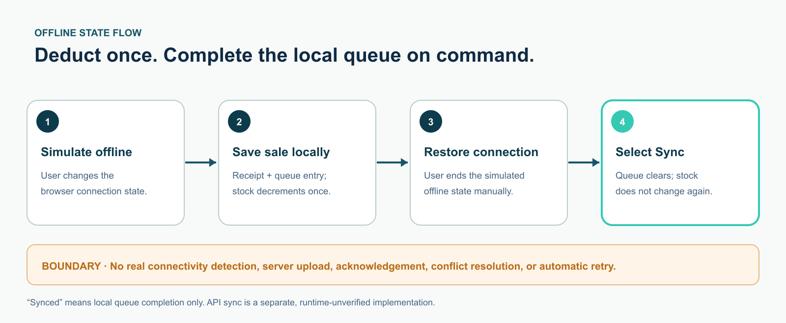

**Critical distinction:** this is a manual local simulation. It does not detect real connectivity or upload to Express/PostgreSQL. “Synced” means local queue completion only. There is no server acknowledgement, conflict resolution, automatic retry, or durable central upload in this workflow.

### 4.7 Administration

Administrators can add local staff-table records, activate/deactivate those records, and inspect local audit events. Branch managers have read-only administration access.

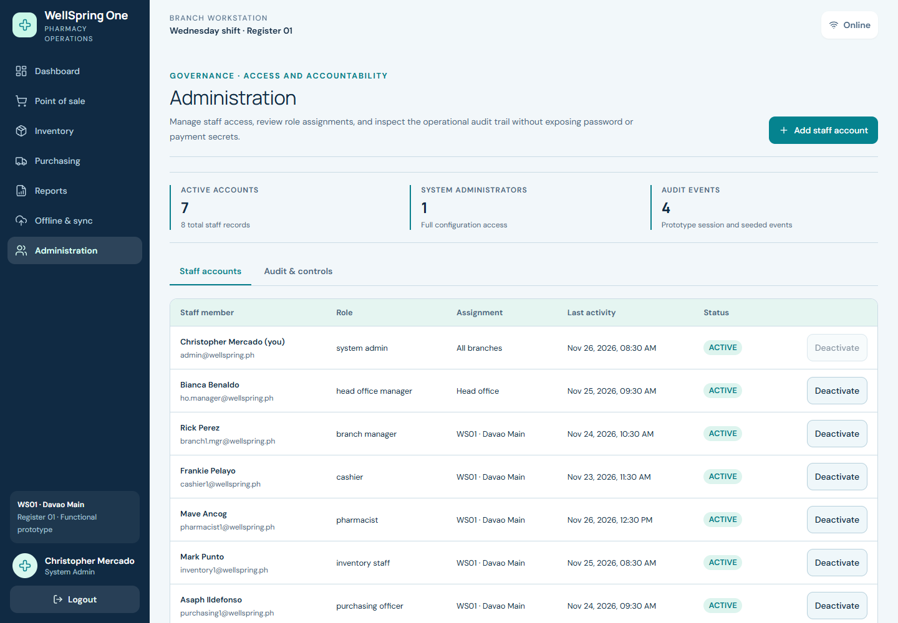

**Boundary:** added records are not working credentials; activation does not govern seeded demo login; local audit is editable through browser storage and erased by reset. It is not tamper-evident.

## 5. Authentication and responsive evidence

The desktop authentication page uses a sliding WellSpring overlay; compact screens use a Sign in/Create account switcher. The application retains self-hosted Manrope and DM Sans, while editable Office deliverables use Arial for portability.

| Desktop sign-in | Desktop signup | Compact mobile sign-in |
|---|---|---|
| 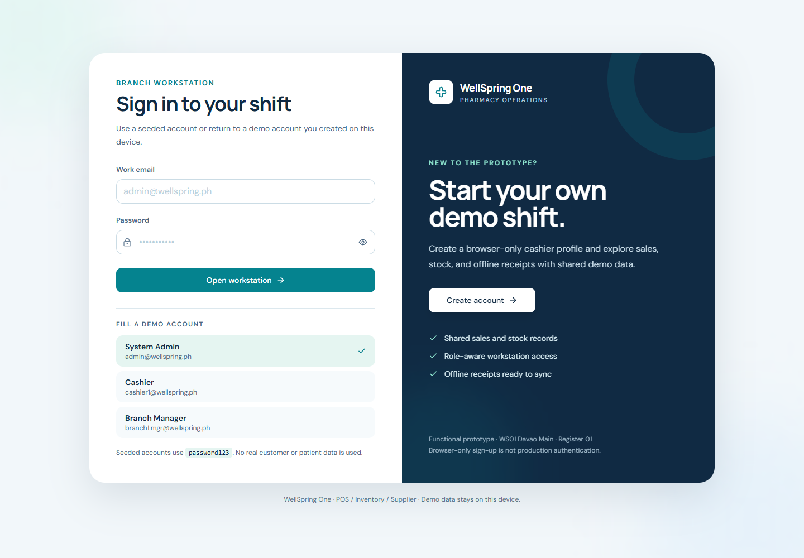 | 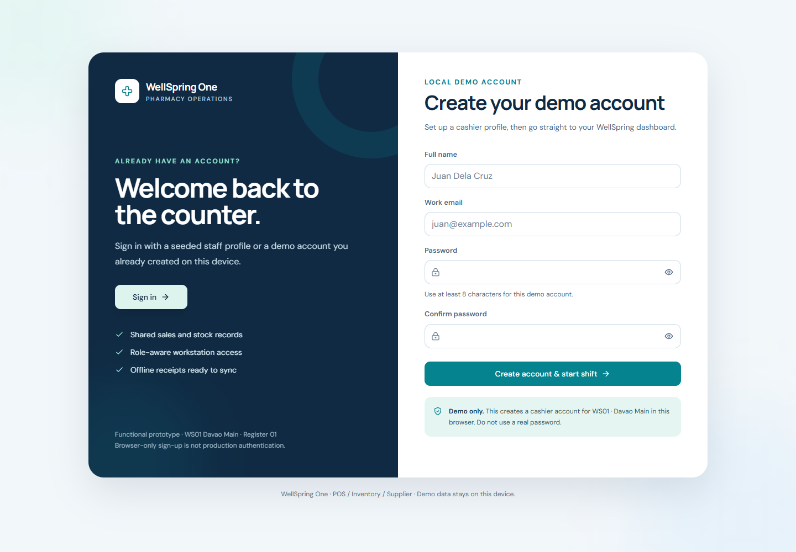 | 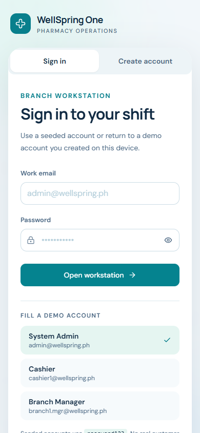 |

Earlier browser QA recorded 16/16 login checks and 28 responsive page/device checks passed. These are prototype checks, not production browser-certification results.

## 6. Use cases and planning artifacts

The retained RFP use-case specification and diagram describe the intended actors and system scope. They are planning artifacts, not proof that every proposed integration is operational.

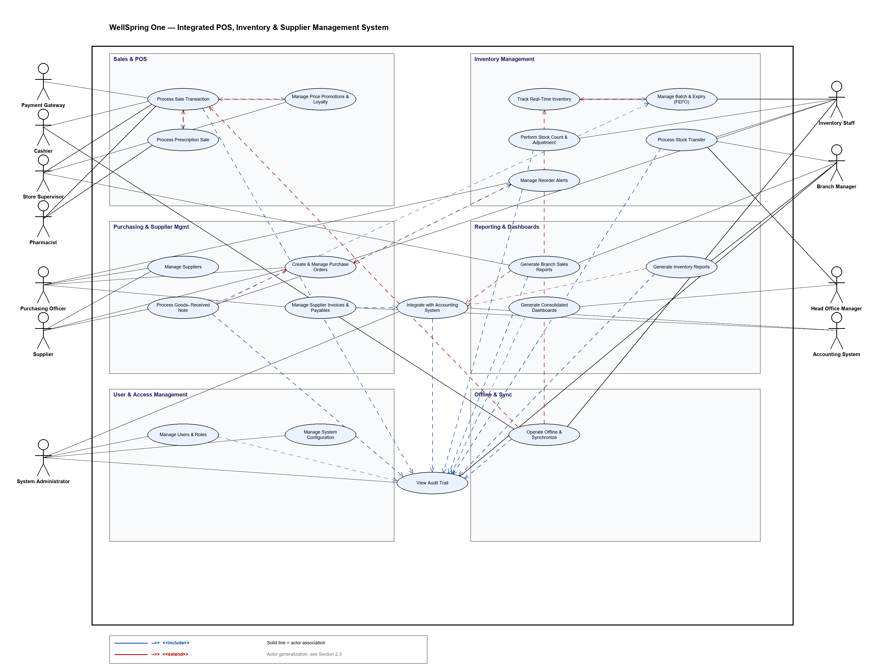

The two-week Gantt chart records the implementation plan and sequencing. It should be read as a project plan, not an actual measured schedule or production rollout commitment.

The combined `WELLSPRING_ONE_SYSTEM_DOCUMENTATION.docx/.pdf` includes the editable Gantt task table, both original Gantt chart pages, and the complete 25-page use-case specification as appendix facsimiles. The separate editable originals remain available for focused editing.

- Editable use cases: `USE_CASE_SPECIFICATION_RFP.docx`; PDF copy included.
- Editable Gantt plan: `GANTT_TWO_WEEK_PLAN.docx`; PDF copy included.
- Full requirement-by-requirement status: [REQUIREMENTS.md](REQUIREMENTS.md).

## 7. Verification summary

| Check | Final recorded result | Interpretation |
|---|---|---|
| API unit tests | **4/4 passed**, 2 files | JWT identity/malformed token and shared permission examples only |
| Web unit tests | **21/21 passed**, 3 files | Sales calculations, dashboard derivations, local signup/login |
| Production builds | **Passed** for API, web, shared | TypeScript/build verification, not runtime integration |
| Web ESLint | **Passed** | Web source lint only |
| Root test command | API/web tests pass; shared workspace reports no test script | Root command is not a clean all-workspace pass |
| Root lint command | **Failed** | API/shared ESLint configuration is missing |
| Browser workflow evidence | 16/16 login and 28 responsive checks; captured POS stock/receipt and offline states | Local browser prototype only |
| Dependency audit | **4 moderate, 8 high, 2 critical** | Requires reviewed remediation; no blind auto-fix applied |
| PostgreSQL/API integration | **Not executed** | PostgreSQL unavailable; migrations/seed/runtime workflows unverified |

See [TEST_PLAN.md](TEST_PLAN.md) for commands, manual cases, acceptance gates, and the defect register.

## 8. Limitations and production roadmap

### 8.1 Current limitations

- Browser operational state is device/profile-specific `localStorage`; API mode changes authentication only.
- Real API/database integration, migrations, seed execution, and multi-client consistency are unverified.
- Offline/Sync is manual and local; API sync idempotency is incomplete in source.
- Authorization and branch isolation require backend remediation and integration tests.
- Frontend/backend senior/PWD calculations differ; compliance review is required.
- Local credentials and audit records are not production-safe.
- Multi-batch/FEFO, complete receiving, browser void/refund, loyalty, accounting, payments, and hardware are incomplete or absent.
- CI/CD and Docker definitions are drafts; dependency vulnerabilities remain.
- PR-01–PR-06, stock accuracy, availability, recovery, privacy, BIR, and training targets have no production evidence.

### 8.2 Recommended next increments

1. Make clean install, lint, tests, and CI reproducible; establish migrations and a dependency-remediation baseline.
2. Correct backend authorization, branch isolation, session restoration, audit redaction, tax rules, and sync idempotency.
3. Integrate one end-to-end server-backed sale, then inventory, purchasing, and reporting.
4. Complete pharmacy batch/FEFO and receiving controls; implement durable offline commands and conflict handling.
5. Add vendor integrations, monitoring, backup/restore, deployment, training, and eight-branch acceptance evidence.

Detailed architecture, endpoints, data models, and security findings are in [TECHNICAL_GUIDE.md](TECHNICAL_GUIDE.md).

## 9. Submission file index

| Artifact | Editable/source form | Reading copy |
|---|---|---|
| Combined system documentation, including full Gantt and use-case appendices | `WELLSPRING_ONE_SYSTEM_DOCUMENTATION.docx`, `WELLSPRING_ONE_SYSTEM_DOCUMENTATION.md` | `WELLSPRING_ONE_SYSTEM_DOCUMENTATION.pdf` |
| Defense presentation | `WELLSPRING_ONE_DEFENSE.pptx`, `PRESENTATION.md` | `WELLSPRING_ONE_DEFENSE.pdf` |
| Presenter/demo guidance | `PRESENTER_DEMO_SCRIPT.md` | Included in speaker notes |
| Requirements | `REQUIREMENTS.md` | Included in main documentation |
| Test plan and QA | `TEST_PLAN.md` | Included in main documentation |
| Architecture/API/handover | `TECHNICAL_GUIDE.md` | Included in main documentation |
| RFP use cases | `USE_CASE_SPECIFICATION_RFP.docx` | `USE_CASE_SPECIFICATION_RFP.pdf` |
| Two-week Gantt | `GANTT_TWO_WEEK_PLAN.docx` | `GANTT_TWO_WEEK_PLAN.pdf` |
| Visual evidence | 12 PNG screenshots and diagram sources | Embedded in documentation/deck |

The Markdown files are the authoritative editable text sources. The DOCX/PPTX are editable presentation formats; PDFs are fixed reading copies. Regenerate all derived files after substantive edits so the evidence stays consistent.
